

  <h1>
    
  </h1>

  
  

  <!-- The Hacker Vibe Subtitle -->
  
<b>A cybersecurity student by day, and a threat actor in training by night. 🔒</b>

  <!-- Stat Badges -->
  

    
    
    
  

🛡️ Cybersecurity Skills

  
  
  

<!--

🌐 Platforms

  
  

//
-->

💻 Languages and Tools

  
  
  
  
  
  
  
  
  
  
  
  

<!--
🏅 Badges
  

  
  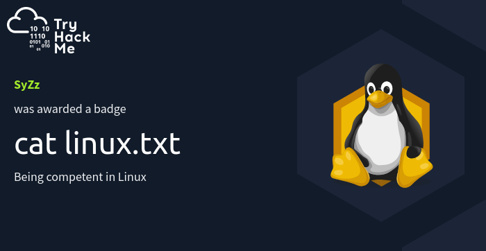
  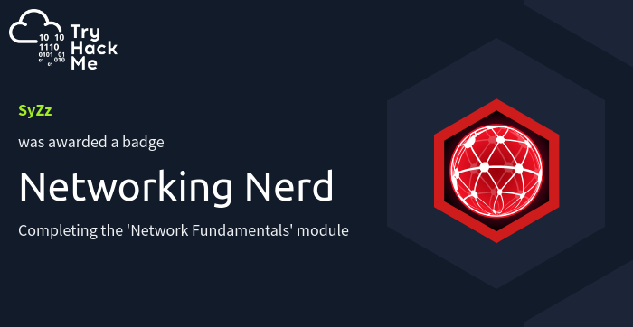
  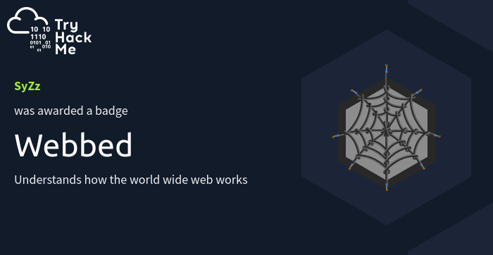
  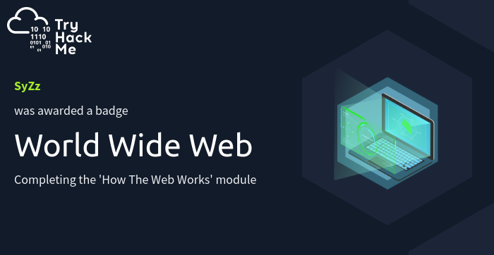
  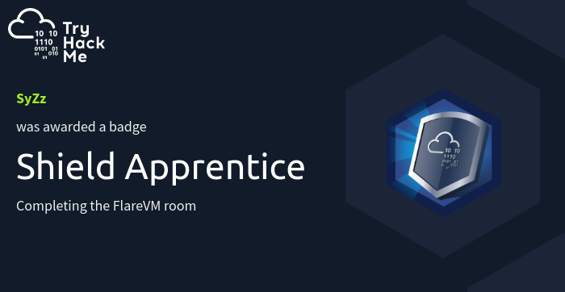
  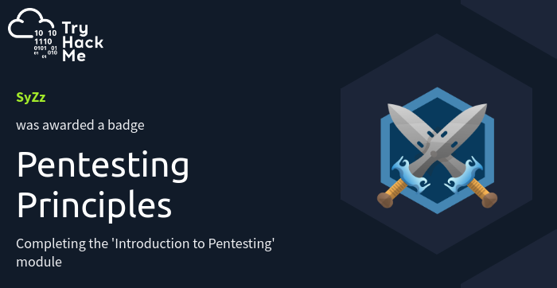
  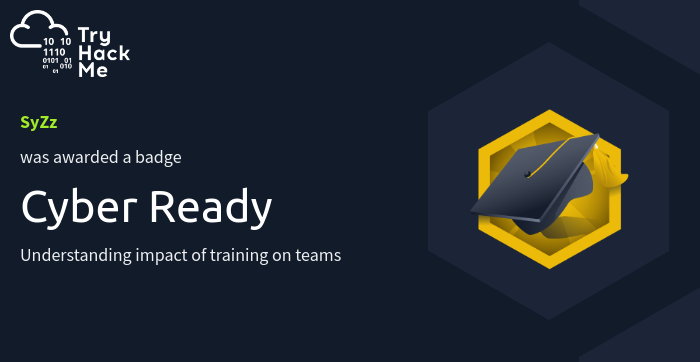
  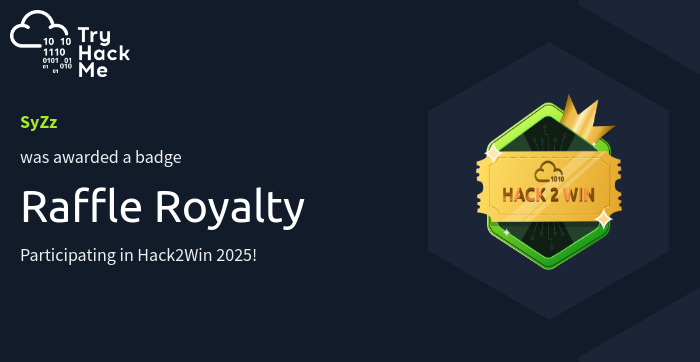
  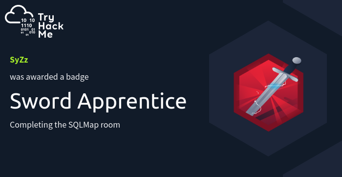
  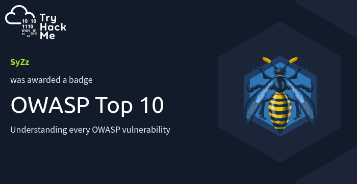
  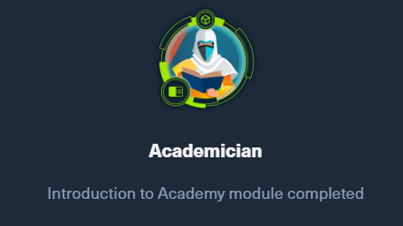
  
  
  
  
  
  
  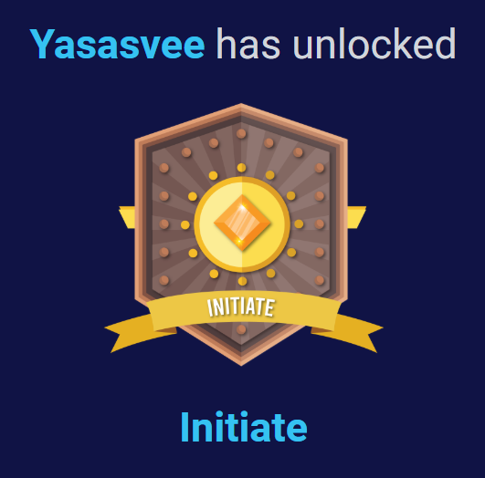

-->
 

   
  <!-- Neon Green Header with Green Shields perfectly aligned -->
  <h2>
     
    
    
  </h2>
   

  <table align="center" border="0" cellspacing="8" cellpadding="0">
    <!-- ROW 1 -->
    <tr>
      <td align="center" valign="middle">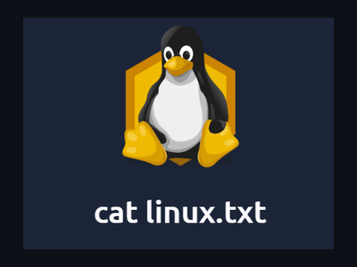</td>
      <td align="center" valign="middle">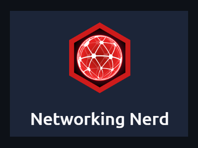</td>
      <td align="center" valign="middle">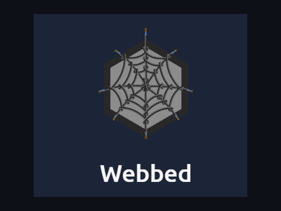</td>
      <td align="center" valign="middle">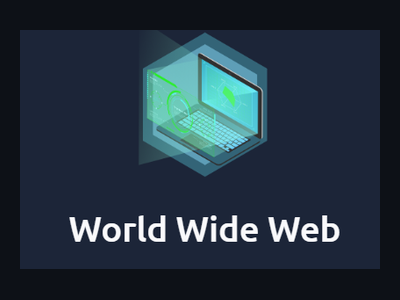</td>
      <td align="center" valign="middle">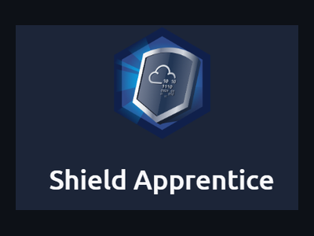</td>
    </tr>
    <!-- ROW 2 -->
    <tr>
      <td align="center" valign="middle">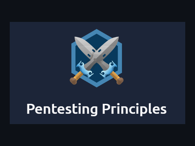</td>
      <td align="center" valign="middle">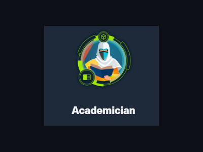</td>
      <td align="center" valign="middle">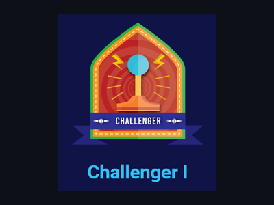</td>
      <td align="center" valign="middle">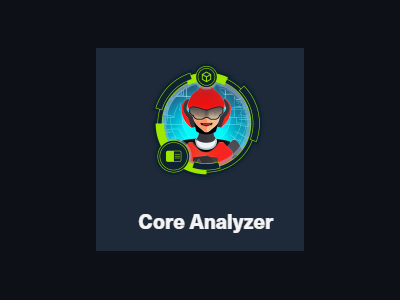</td>
      <td align="center" valign="middle"></td>
    </tr>
    <!-- ROW 3 -->
    <tr>
      <td align="center" valign="middle">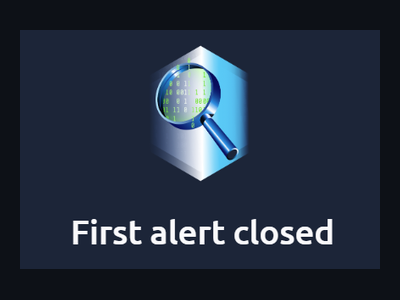</td>
      <td align="center" valign="middle">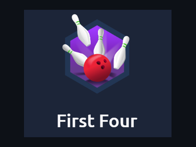</td>
      <td align="center" valign="middle">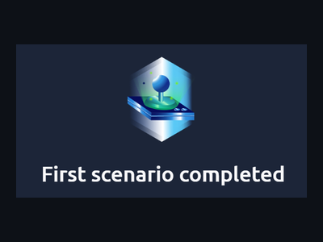</td>
      <td align="center" valign="middle">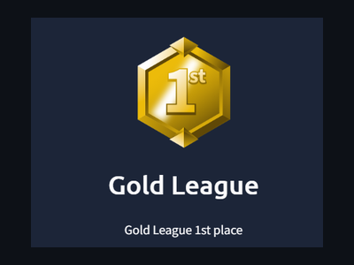</td>
      <td align="center" valign="middle">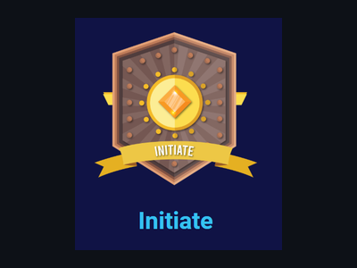</td>
    </tr>
    <!-- ROW 4 -->
    <tr>
      <td align="center" valign="middle">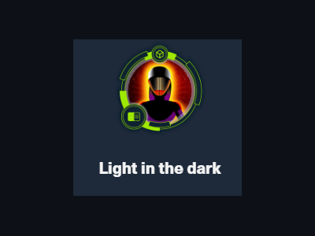</td>
      <td align="center" valign="middle">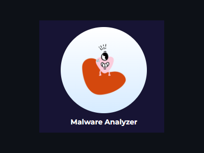</td>
      <td align="center" valign="middle">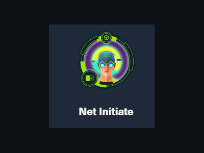</td>
      <td align="center" valign="middle">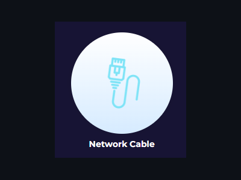</td>
      <td align="center" valign="middle">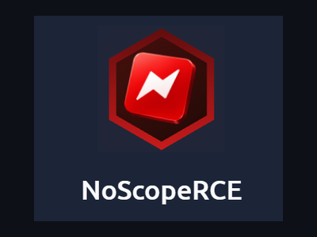</td>
    </tr>
    <!-- ROW 5 (4 badges perfectly centered, no borders) -->
    <tr>
      <td colspan="5" align="center" valign="middle">
        <table border="0" cellspacing="8" cellpadding="0">
          <tr>
            <td align="center" valign="middle">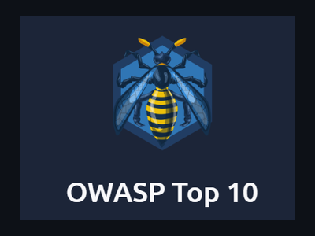</td>
            <td align="center" valign="middle">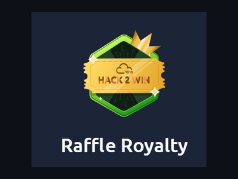</td>
            <td align="center" valign="middle">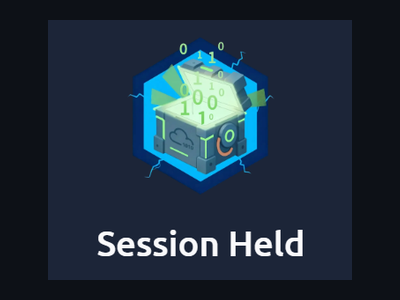</td>
            <td align="center" valign="middle">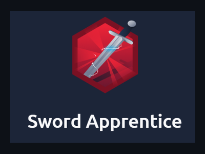</td>
          </tr>
        </table>
      </td>
    </tr>
  </table>

  

<!-- Neon Green Header -->

  <h2>
    
  </h2>

  <!-- LinkedIn (With Icon) -->
  
  
  <!-- TryHackMe (Red Icon, Neon Green Text) -->
  
  
  <!-- Instagram -->
  
  
  <!-- Discord -->
  
  
  <!-- Gmail -->
  

   
  
   

